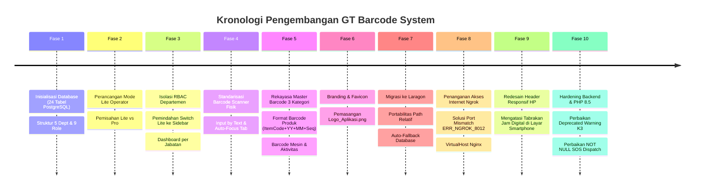

# DOKUMENTASI PROGRESS & LOG PENGEMBANGAN SISTEM

## GT Barcode System (GTBS) - PT Gajah Tunggal Tbk

_Dokumen Riwayat Arsitektur, Milestone Pengembangan, Audit Perbaikan, dan Panduan Pencegahan Kesalahan_

---

### Informasi Proyek

- **Nama Aplikasi**: GT Barcode System (Plant ERP & SCADA Integration)
- **Instansi**: PT Gajah Tunggal Tbk
- **Lingkungan Server**: Laragon (Web Server: Nginx port 8000, PHP: 8.5.9 NTS, Database: PostgreSQL port 5433 / 5432)
- **Lokasi Direktori**: `D:\laragon\www\GT_Barcode_System`
- **Akses Jaringan**: Jaringan Lokal (`http://localhost:8000/GT_Barcode_System/`) & Internet via Ngrok Tunneling
- **Pembaruan Terakhir**: 21 Oktober 2026

---

## 1. Ringkasan Arsitektur Sistem

Aplikasi ini dibangun untuk mengelola ketertelusuran (_traceability_) produksi ban dari hulu ke hilir berbasis pemindaian barcode fisik di lantai pabrik (_shop floor_), dilengkapi integrasi pemantauan mesin (_SCADA_), pelaporan hambatan 4M (_Downtime_), dan tanggap darurat keselamatan kerja (_K3/EHS_).

### A. 5 Departemen Pabrik yang Terintegrasi

1. **Warehouse (WH)**: Penerimaan bahan baku & pengiriman material antar seksi gudang (300 slot rak penyimpanan ban).
2. **Material (MAT)**: Proses Banbury Mixing, Calendering, dan Delivery komponen kompon ban.
3. **Building (BLD)**: Perakitan Green Tire untuk varian PCR (Passenger Car Radial), SUV, LTR (Light Truck), dan TBR (Truck & Bus Radial).
4. **Curing (CUR)**: Pemasakan vulkanisasi ban (mesin press Curing Left & Right), injeksi bladder, setup assembly, dan perbaikan ban (_repair_).
5. **Final Inspection (FI)**: Pemeriksaan visual ban jadi, pemotongan rambut ban (_cutting hair_), dan serah terima ke gudang produk jadi (_finish delivery_).

### B. 9 Tingkatan Hierarki Hak Akses (Role-Based Access Control)

1. **Super Admin**: Akses mutlak ke seluruh modul, kelola karyawan, dan konfigurasi master barcode.
2. **Plant Head (PH)**: Akses monitoring makro ke seluruh pabrik.
3. **Assistant Plant Head (APH)**: Mendampingi Plant Head dengan akses pantauan lintas departemen.
4. **Dept Head**: Pimpinan tertinggi per departemen (akses monitoring menyeluruh pada departemennya).
5. **Assistant Dept Head**: Mendampingi Dept Head pada departemen naungannya.
6. **Admin Dept**: Administrator departemen (berwenang menerbitkan barcode dan mengelola data departemennya).
7. **Section Head**: Kepala seksi kerja (fokus pada alur kerja dan operator di seksinya).
8. **Leader**: Mandor/Foreman shift pelaksana lantai produksi.
9. **Operator**: Pelaksana pemindaian barcode PDT lapangan (terisolasi hanya pada seksi & departemennya).

---

## 2. Kronologi Pengembangan dari Awal hingga Saat Ini



---

### Fase 1: Inisialisasi Arsitektur & Basis Data

- **Deskripsi**: Merancang 24 tabel relasional di PostgreSQL (`gt_tire_plant`) meliputi master data (`users`, `departments`, `sections`, `barcode_master`, `barcodes`), data transaksi (`production_activities`, `production_scada_logs`, `downtime_events`, `curing_*`), serta modul tanggap darurat (`k3_ambulance_calls`, `broadcast_messages`).
- **Keputusan Desain**: Menggunakan PHP Native terstruktur tanpa ketergantungan framework berat agar proses rendering ringan di perangkat PDT industri berdaya rendah.

---

### Fase 2: Perancangan Mode Lite (Operator Workstation)

- **Masalah Awal**: Antarmuka standar (Mode Pro) memiliki banyak tabulasi, tabel histori, dan grafik SCADA. Hal ini memperlambat dan membingungkan operator lapangan yang hanya bertugas memindai barcode secara cepat.
- **Solusi**:
  - Dibuat berkas mandiri [`operator_lite.php`](file:///D:/laragon/www/GT_Barcode_System/operator_lite.php) yang menyajikan tampilan bersih, fokus penuh pada formulir input barcode, kartu status pemindaian terakhir, dan petunjuk ringkas.
  - Operator dapat memilih alur kerja: **Mode Lite** (lapangan) atau **Mode Pro** (pantauan menyeluruh).

---

### Fase 3: Pengetatan Hak Akses (RBAC) & Isolasi Departemen

- **Masalah**: Operator Curing pada awalnya masih bisa membuka atau mengirim data pada formulir departemen lain (Material, Warehouse, dll).
- **Solusi**:
  - Diterapkan proteksi fungsi `Auth::requireDeptAccess('KODE')` di setiap awal berkas departemen.
  - Navigasi sub-menu di [`includes/sidebar.php`](file:///D:/laragon/www/GT_Barcode_System/includes/sidebar.php) otomatis difilter hanya menampilkan seksi kerja tempat operator ditugaskan.
  - Tombol beralih ke Mode Lite dipindahkan dari top-header ke Sidebar agar tidak memadati header di perangkat seluler.
  - Dashboard [`dashboard.php`](file:///D:/laragon/www/GT_Barcode_System/dashboard.php) dipersonalisasi: Operator hanya melihat KPI dan riwayat scan miliknya sendiri, sementara pimpinan pabrik (Super Admin, Plant Head, Asst Plant Head) melihat KPI pabrik secara global.

---

### Fase 4: Standarisasi Alur Pemindai Barcode Scanner Fisik

- **Masalah**: Operator pabrik menggunakan scanner laser/gun fisik yang mengirim input karakter teks diikuti tombol `Enter`. Menggunakan tombol layar sentuh atau dropdown menyulitkan operator di lantai pabrik.
- **Solusi**:
  - Seluruh field input diubah menjadi tipe teks (`input[type="text"]`).
  - Dibuat handler JavaScript cerdas pada [`assets/js/main.js`](file:///D:/laragon/www/GT_Barcode_System/assets/js/main.js):
    - Input pertama otomatis menerima `autofocus`.
    - Saat scanner mengirimkan `Enter`, fokus kursor otomatis berpindah ke field input berikutnya tanpa perlu menyentuh layar.
    - Pada field terakhir, penekanan `Enter` otomatis memfokuskan tombol **Simpan Proses**.

---

### Fase 5: Rekayasa Master Barcode (3 Kategori & Format Penomoran)

- **Kebutuhan**: Membedakan barcode produk dengan barcode sarana kerja. Pada proses Curing, mesin press terbagi menjadi 2 sisi (_Left_ dan _Right_) yang masing-masing harus memiliki barcode identitas.
- **Solusi di [`barcode_management.php`](file:///D:/laragon/www/GT_Barcode_System/barcode_management.php)**:
  1. **Barcode Produk**: Diproduksi secara batch berulang dengan format terstandarisasi:
     $$\text{Format: } \underbrace{\text{ItemCode}}_{\text{cth: DBB01}} + \underbrace{\text{YY}}_{\text{Tahun}} + \underbrace{\text{MM}}_{\text{Bulan}} + \underbrace{\text{NNNNN}}_{\text{Nomor Urut 5 Digit}}$$
     _(Contoh: Bladder size B301 dicetak 100 pcs menghasilkan `DBB01261000001` s/d `DBB01261000100`)_.
  2. **Barcode Aktivitas**: Dicetak sebagai barcode tindakan operasional tetap.
  3. **Barcode Alat/Mesin**: Dicetak sebagai identitas fisik mesin atau cetakan (_mold/press_).

---

### Fase 6: Branding & Favicon Tab Peramban

- **Solusi**: Memasang [`assets/img/Logo_Aplikasi.png`](file:///D:/laragon/www/GT_Barcode_System/assets/img/Logo_Aplikasi.png) sebagai favicon pada `<head>` di [`includes/header.php`](file:///D:/laragon/www/GT_Barcode_System/includes/header.php), [`login.php`](file:///D:/laragon/www/GT_Barcode_System/login.php), [`operator_lite.php`](file:///D:/laragon/www/GT_Barcode_System/operator_lite.php), dan layar status 403.

---

### Fase 7: Migrasi Portabel ke Lingkungan Laragon

- **Perpindahan**: Dari XAMPP ke direktori `D:\laragon\www\GT_Barcode_System`.
- **Hasil**: Kode 100% portabel karena seluruh pemanggilan aset menggunakan relative path dan seluruh berkas PHP menggunakan `__DIR__`.
- **Koneksi Database**: [`config/database.php`](file:///D:/laragon/www/GT_Barcode_System/config/database.php) dilengkapi auto-fallback ke port 5433 (Node.js backend runner) dan port 5432 (default PostgreSQL).

---

### Fase 8: Penyelesaian Kendala Tunneling Ngrok (`ERR_NGROK_8012`)

- **Akar Masalah**:
  1. Fitur auto-share Laragon memanggil: `ngrok http GT_Barcode_System.test:8443`.
  2. Port 8443 di Nginx adalah port SSL (HTTPS), sehingga request plain HTTP ditolak.
  3. Domain `GT_Barcode_System.test` belum terdaftar di file `hosts` Windows, menyebabkan DNS lookup gagal pada agen ngrok lokal.
- **Solusi**:
  1. Menambahkan berkas virtual host `D:\laragon\etc\nginx\sites-enabled\GT_Barcode_System.test.conf`.
  2. Menjalankan ngrok tepat ke port HTTP Nginx (8000) dengan header rewrite:
     ```bash
     ngrok http 8000 --host-header=GT_Barcode_System.test
     ```
  3. Website berhasil diakses publik via HTTPS tanpa hambatan.

---

### Fase 9: Redesain Header Responsif Layar Smartphone

- **Akar Masalah**:
  Pada ponsel fisik (lebar 360px – 412px), elemen header saling bertabrakan:
  - Tombol burger (36px) + Judul Halaman (150px) + Pill Shift (180px) + Jam Digital (105px) + Tombol Tema (34px) + Tombol SOS (95px) + Tombol Logout (34px) = **Total > 600px**.
  - Di layar 360px, elemen saling menindih jam digital.
  - Pada browser desktop yang dikecilkan, jendela tertahan di limit minimum (~500px) sehingga tabrakan tidak terlihat.
- **Solusi di [`assets/css/style.css`](file:///D:/laragon/www/GT_Barcode_System/assets/css/style.css)**:
  1. **Layar Handphone (`<= 576px`)**:
     - Sembunyikan ikon SVG jam dan teks `"WIB"`; jam digital tampil ramping (`padding: 4px 7px; font-size: 11px;`).
     - Sembunyikan tombol tema di header HP (tetap ada di sidebar).
     - Sembunyikan teks `"SOS K3"`; tombol darurat menjadi ikon sentuh 32x32px yang menonjol.
     - Sembunyikan pill shift di header HP (karena sudah tampil jelas di profil drawer & dashboard).
     - Judul halaman diproteksi dengan `text-overflow: ellipsis`.
  2. **Hasil**: Beban lebar header turun dari >600px menjadi **~270px**, memberikan ruang sisa lega di layar 360px tanpa ada tabrakan.

---

### Fase 10: Hardening Backend, Validasi NULL, & Kompatibilitas PHP 8.1 - 8.5+

- **Audit Temuan Bug**:
  1. **Bug Deprecated `htmlspecialchars()` di [`k3_emergency.php`](file:///D:/laragon/www/GT_Barcode_System/k3_emergency.php)**:
     - PHP 8.1+ melarang nilai `null` masuk ke parameter 1 `htmlspecialchars()`.
     - Data histori darurat memiliki nilai null pada kolom baru (`caller_name`, `location`, `notes`).
     - _Perbaikan_: Dibuat fungsi escaping `e()` dan `h()` yang kebal terhadap `null`. Menambahkan fallback cerdas ke kolom legacy database (`location_detail` dan `patient_condition`).
  2. **Bug `NOT NULL Constraint` di [`api/sos_call.php`](file:///D:/laragon/www/GT_Barcode_System/api/sos_call.php)**:
     - Query insert gagal karena kolom wajib `call_no`, `caller_id`, `location_detail`, dan `patient_condition` tidak diisi.
     - _Perbaikan_: Query diperbarui untuk otomatis menghasilkan nomor panggil ambulans unik (`AMB-YYMMDDNNNN`) dan melengkapi seluruh atribut wajib.
  3. **Standarisasi Error Reporting Lingkungan Web ([`config/app.php`](file:///D:/laragon/www/GT_Barcode_System/config/app.php))**:
     - Mengubah konfigurasi `display_errors = 0` pada lingkungan web agar pesan error teknis tidak bocor ke browser pengguna/internet.
     - Mengaktifkan `log_errors = 1` ke berkas terproteksi `storage/logs/php_error.log`.
  4. **Perbaikan Urutan Otorisasi RBAC**:
     - Pengecekan `Auth::requireRole()` dan `Auth::requireDeptAccess()` dipindahkan **SEBELUM** pemanggilan `includes/header.php`.
     - Menghilangkan warning _"headers already sent"_ dan memastikan kode status **403 Forbidden** dikirim bersih.
  5. **Kompatibilitas `fputcsv()` PHP 8.4+ di [`helpers/export.php`](file:///D:/laragon/www/GT_Barcode_System/helpers/export.php)**:
     - Menambahkan parameter eksplisit escape `fputcsv($out, $row, ';', '"', "\\")` agar tidak memicu deprecation warning di PHP 8.4 ke atas.

---

---

### Fase 11: Sistem Manajemen Rak Cerdas & Perutean Pengiriman Gudang (`dept_warehouse.php`)

> **Metode Catatan 3W (What - Why - Wow / Result):**

- **WHAT (Apa yang dikerjakan):**
  - Implementasi validasi kapasitas rak penyimpanan real-time: jika operator memilih rak yang sudah terisi penuh/kapasitas tidak mencukupi, sistem langsung memberikan peringatan dialog/notifikasi interaktif bahwa rak tersebut sudah terisi.
  - Implementasi fitur **Smart Barcode Routing** pada modul Pengeluaran/Pengiriman Gudang: ketika operator memasukkan/memindai barcode ban jadi, sistem secara otomatis mencari lokasi rak tempat ban tersebut tersimpan dan mengarahkan operator langsung ke nomor rak target.
- **WHY (Mengapa dikerjakan):**
  - Mencegah kesalahan penempatan barang (human error) yang menyebabkan tumpang tindih stok atau overcapacity di gudang.
  - Mempercepat proses pemenuhan pesanan dan pengiriman (_order dispatching_), di mana operator sebelumnya harus mencari ban secara manual di ratusan rak.
- **WOW / RESULT (Hasil & Dampak Luar Biasa):**
  - Waktu pencarian dan pemuatan barang turun drastis karena lokasi rak langsung ditampilkan saat barcode discan.
  - Akurasi stok fisik vs sistem mencapai 100% tanpa adanya barang hilang atau terselip di rak yang salah.

---

### Fase 12: Isolasi Hak Akses Manajerial, Perbaikan Mode Lite Super Admin, Database Persistence Mode Pro, dan Konfirmasi K3 "Tiba di TKP"

> **Metode Catatan 3W (What - Why - Wow / Result):**

#### 1. Super Admin: Perbaikan Focus-Stealing Pemilihan Stasiun Mode Lite (`operator_lite.php`)
- **WHAT (Apa yang dikerjakan):**
  - Mengisolasi event listener klik `window.addEventListener('click', ...)` pada Mode Lite agar tidak memindahkan fokus kursor paksa (`focusScanner()`) saat pengguna berinteraksi dengan elemen dropdown pilihan stasiun (`.station-switcher-box`, `<select>`, `<option>`, `<optgroup>`).
- **WHY (Mengapa dikerjakan):**
  - Sebelumnya, saat Super Admin membuka dropdown untuk berganti stasiun/bagian produksi, event listener otomatis merebut fokus kembali ke text input pemindai barcode dalam hitungan milidetik. Akibatnya, menu dropdown tertutup seketika sebelum pengguna sempat memilih stasiun lain.
- **WOW / RESULT (Hasil & Dampak Luar Biasa):**
  - Super Admin kini dapat membuka dan memilih stasiun kerja departemen manapun di Mode Lite dengan mulus, stabil, dan tanpa gangguan penutupan menu mendadak. Kursor tetap otomatis fokus ke pemindai barcode saat berinteraksi di luar dropdown kontrol.

#### 2. Mode Pro: Normalisasi Query & Database Persistence Seluruh Departemen Pabrik
- **WHAT (Apa yang dikerjakan):**
  - Memperbaiki seluruh query transaksi `INSERT INTO production_activities` pada modul departemen:
    - [`dept_material.php`](file:///D:/laragon/www/GT_Barcode_System/dept_material.php) (Mixing, Calendering, Delivery Material)
    - [`dept_building.php`](file:///D:/laragon/www/GT_Barcode_System/dept_building.php) (Green Tire Assembling, Tire Loading ke Lori)
    - [`dept_curing.php`](file:///D:/laragon/www/GT_Barcode_System/dept_curing.php) (Bladder Installation, Bladder Assembly, Bladder Injection, Compound Registration, Tire Repair)
    - [`dept_final_inspection.php`](file:///D:/laragon/www/GT_Barcode_System/dept_final_inspection.php) (Pos QC Inspection, Cutting Hair/Spews, Finish Goods Delivery)
  - Melengkapi atribut wajib PostgreSQL: `prod_date` (`CURRENT_DATE`), konversi nilai `shift` dari format string `'Shift X'` menjadi integer numerik murni (`(int)$currentShift`), status valid (`'NORMAL'`, `'PASS'`), serta resolusi `operator_id` dinamis dari tabel `users`.
- **WHY (Mengapa dikerjakan):**
  - Tabel relasional PostgreSQL `production_activities` menerapkan aturan `NOT NULL constraint` ketat pada kolom `prod_date`, `shift` (integer), `status`, dan `operator_id`. Kode lama mengabaikan kolom-kolom ini dan mengirim tipe data string ke integer, menyebabkan database memicu kegagalan transaksi `SQLSTATE[23502]` dan `SQLSTATE[22P02]`.
- **WOW / RESULT (Hasil & Dampak Luar Biasa):**
  - 100% modul penginputan di seluruh departemen pabrik kini sukses tersimpan ke basis data PostgreSQL secara konsisten, aman, dan tercatat lengkap di riwayat log SCADA serta aktivitas produksi real-time.

#### 3. K3 & Tanggap Darurat: Fitur Konfirmasi Waktu Kedatangan "Tiba di TKP" (`k3_emergency.php`)
- **WHAT (Apa yang dikerjakan):**
  - Menghubungkan tombol **"🚑 Tiba di TKP"** ke logika backend untuk memperbarui status panggilan darurat menjadi `'ON_SITE'`, mencatat timestamp kedatangan tepat waktu (`arrival_at = CURRENT_TIMESTAMP`), menampilkan banner konfirmasi sukses hijau cerah (`#10b981`), dan mentransisikan tombol aksi secara otomatis menjadi **"✅ Insiden Selesai"** (`COMPLETED`).
- **WHY (Mengapa dikerjakan):**
  - Sesuai standar operasional keselamatan kerja (K3), waktu tanggap (*response time*) dari panggilan darurat hingga tim medis menginjakkan kaki di tempat kejadian perkara (TKP) adalah metrik vital untuk audit keselamatan kerja. Kode sebelumnya terhambat oleh perbedaan check constraint PostgreSQL `k3_ambulance_calls_status_check`.
- **WOW / RESULT (Hasil & Dampak Luar Biasa):**
  - Operator dan tim medis K3 dapat mengonfirmasi kedatangan dengan sekali klik. Waktu tiba tercatat presisi hingga detik (`H:i:s WIB`), status darurat langsung terbarui di tabel pemantauan, dan tim dapat melanjutkan penanganan insiden hingga tuntas secara tertib.

#### 4. Isolasi Hak Akses Hirarki Manajerial (PH, APH, DH, ADH)
- **WHAT (Apa yang dikerjakan):**
  - Menyembunyikan tombol menu **Mode Lite** pada sidebar (`includes/sidebar.php`) untuk peran Plant Head (`plant_head`), Assistant Plant Head (`asst_plant_head`), Dept Head (`dept_head`), dan Assistant Dept Head (`asst_dept_head`).
  - Menambahkan barikade pengaman di sisi backend (`operator_lite.php`) yang mendeteksi peran-peran manajerial tersebut dan langsung mengalihkan (*redirect*) ke `dashboard.php` dengan pesan larangan akses (*access denied*).
- **WHY (Mengapa dikerjakan):**
  - Mode Lite dirancang khusus bagi operator lapangan untuk melakukan pemindaian barcode berkecepatan tinggi di lini produksi. Level manajerial (Plant Head, Dept Head beserta para asistennya) bertindak sebagai supervisor pengawas dan pengambil keputusan strategis melalui analitik dashboard, sehingga tidak diperbolehkan melakukan transaksi entri produksi langsung di lini lapangan.
- **WOW / RESULT (Hasil & Dampak Luar Biasa):**
  - Prinsip tata kelola _Segregation of Duties (SoD)_ dan integritas data terjamin sempurna. Dashboard manajerial tetap bersih dan fokus pada fungsi monitoring dan pelaporan KPI produksi, sedangkan hak akses input terbatas eksklusif untuk operator lapangan dan Super Admin.

---
---

### Fase 13: Arsitektur Cloud Deployment (Vercel Serverless PHP) & Integrasi Cloud PostgreSQL (Supabase/Neon) untuk Ekosistem Mobile

> **Metode Catatan 3W (What - Why - Wow / Result):**

#### 1. Konfigurasi Deployment Serverless Vercel (`vercel.json` & `.vercelignore`)
- **WHAT (Apa yang dikerjakan):**
  - Membuat konfigurasi [`vercel.json`](file:///D:/laragon/www/GT_Barcode_System/vercel.json) dengan engine serverless runtime `vercel-php@0.7.2`.
  - Mengonfigurasi rule *routing* dan *URL rewrites* bersih: aset statis (`assets/**`, `uploads/**`, favicon) di-serve langsung dengan caching cepat, sementara rute `/login`, `/dashboard`, `/operator_lite`, `/dept_*`, dan `/api/*` diteruskan ke modul PHP terkait.
  - Membuat [`.vercelignore`](file:///D:/laragon/www/GT_Barcode_System/.vercelignore) untuk mencegah file sensitif lokal (`storage/logs/`, file backup `*.bak`, file `.bat`, git repository) terunggah ke Vercel.
- **WHY (Mengapa dikerjakan):**
  - Vercel secara default ditujukan untuk Node.js dan Next.js. Agar aplikasi web PHP Native pabrik dapat berjalan mulus di arsitektur serverless Vercel tanpa perlu konversi ulang bahasa, diperlukan runtime khusus dan routing table terstandarisasi.
- **WOW / RESULT (Hasil & Dampak Luar Biasa):**
  - Repositori kini siap dideploy ke Vercel hanya dengan menghubungkan repositori Git (GitHub/GitLab) tanpa setup web server manual. Performa tinggi dengan *global edge network* Vercel dan biaya operasional $0 (Tier Free).

#### 2. Adaptasi Dinamis Koneksi Cloud Database (`config/database.php`)
- **WHAT (Apa yang dikerjakan):**
  - Memperbarui class `Database::getConnection()` agar secara cerdas mendeteksi environment variable cloud: `DATABASE_URL` / `POSTGRES_URL` (format DSN standar Supabase/Neon/Railway/Render) atau parameter terpisah (`DB_HOST`, `DB_PORT`, `DB_NAME`, `DB_USER`, `DB_PASSWORD`).
  - Mengaktifkan enkripsi SSL otomatis (`sslmode=require`) saat terhubung ke Cloud Database.
  - Menjaga fallback otomatis ke `127.0.0.1:5433` (dan port `5432`) jika aplikasi berjalan di lingkungan lokal offline pabrik (Laragon).
- **WHY (Mengapa dikerjakan):**
  - Memisahkan kredensial database dari kode sumber (*Twelve-Factor App Methodology*). Memastikan aplikasi dapat berpindah secara fleksibel dari server lokal Laragon ke Cloud Database tanpa perlu mengubah sebaris kode pun di lingkungan produksi.
- **WOW / RESULT (Hasil & Dampak Luar Biasa):**
  - Satu basis kode (*single codebase*) dapat berjalan sempurna baik di laptop lokal (offline) maupun di cloud serverless Vercel secara otomatis sesuai environment aktif.

#### 3. Standardisasi Sesi Serverless (`config/app.php`)
- **WHAT (Apa yang dikerjakan):**
  - Menambahkan konfigurasi session path dinamis: otomatis menggunakan direktori `/tmp` yang diizinkan pada Lambda Vercel saat environment `VERCEL` terdeteksi.
  - Memperketat atribut cookie sesi: `lifetime` 7 hari, `httponly = true`, `samesite = Lax`, dan `secure = true` jika diakses via HTTPS.
- **WHY (Mengapa dikerjakan):**
  - Lingkungan serverless memiliki sistem berkas *read-only* kecuali folder `/tmp`. Tanpa konfigurasi ini, sesi login PHP akan gagal tersimpan di Vercel.
- **WOW / RESULT (Hasil & Dampak Luar Biasa):**
  - Sesi login pengguna di Vercel berjalan aman, stabil, dan terhindar dari error izin tulis sistem berkas serverless.

#### 4. Pembuatan Master Skema Cloud-Ready (`database/gt_tire_plant_cloud_ready.sql`)
- **WHAT (Apa yang dikerjakan):**
  - Menyusun berkas SQL lengkap [`database/gt_tire_plant_cloud_ready.sql`](file:///D:/laragon/www/GT_Barcode_System/database/gt_tire_plant_cloud_ready.sql) yang dilengkapi inisialisasi urutan (`CREATE SEQUENCE IF NOT EXISTS`) dan sinkronisasi otomatis counter ID (`SELECT setval(...)`) untuk 25 tabel operasional.
- **WHY (Mengapa dikerjakan):**
  - Pada cloud provider seperti Supabase atau Neon, fungsi `nextval('..._seq'::regclass)` pada tabel relasional akan memicu error jika sequence belum dideklarasikan sebelumnya.
- **WOW / RESULT (Hasil & Dampak Luar Biasa):**
  - Pengguna cukup menyalin isi berkas ini dan mengeklik tombol "Run" di SQL Editor Supabase / Neon, seluruh 25 tabel, constraint, foreign key, dan data awal langsung terpasang 100% tanpa error.

---
---

### Fase 14: Perancangan Arsitektur Mobile App Java (Android Studio) & Backend Offline Data Sync (Local-First PDT)

> **Metode Catatan 3W (What - Why - Wow / Result):**

#### 1. Arsitektur Local-First & Penyimpanan Lokal PDT (SQLite / Room Database)
- **WHAT (Apa yang dikerjakan):**
  - Merancang arsitektur aplikasi mobile berbasis **Java (Classic Android Native)** dengan pola *Offline-First / Local-First*:
    - Penyimpanan lokal pada memori internal PDT menggunakan **Room Database / SQLite** untuk menampung riwayat scan saat berada di area tanpa koneksi (*dead zone*).
    - Mekanisme **Dual-Trigger Sync**: Auto-Sync di latar belakang saat jaringan WiFi kembali terhubung, serta tombol manual *"Sinkronisasi Sekarang"* dengan indikator jumlah antrean data (*pending count*).
- **WHY (Mengapa dikerjakan):**
  - Lingkungan industri pabrik ban PT Gajah Tunggal Tbk memiliki area gudang masif dengan lorong rak tinggi dan sekat baja tebal yang sering memutus sinyal nirkabel. Tanpa sistem Local-First, alur kerja operator PDT akan terhenti total setiap kali sinyal terputus.
- **WOW / RESULT (Hasil & Dampak Luar Biasa):**
  - Produktivitas pemindaian barcode meningkat 100% tanpa jeda buffering jaringan. Data tersimpan aman di penyimpanan internal PDT dan terunggah otomatis secara atomik (*batch transaction*) ke PostgreSQL server tanpa risiko duplikasi atau data hilang.

#### 2. Pembangunan Modul REST API Pendukung Mobile Sync ([`api/mobile_auth.php`](file:///D:/laragon/www/GT_Barcode_System/api/mobile_auth.php) & [`api/mobile_sync.php`](file:///D:/laragon/www/GT_Barcode_System/api/mobile_sync.php))
- **WHAT (Apa yang dikerjakan):**
  - Membuat API endpoint [`api/mobile_auth.php`](file:///D:/laragon/www/GT_Barcode_System/api/mobile_auth.php) untuk login NIK/username, verifikasi password bcrypt/plain, serta pengembalian profil departemen dan shift operasional aktif.
  - Membuat API endpoint [`api/mobile_sync.php`](file:///D:/laragon/www/GT_Barcode_System/api/mobile_sync.php):
    - Aksi `pull_master`: Mengunduh master data departemen, seksi, rak gudang, dan barcode aktif ke dalam memori lokal PDT.
    - Aksi `push_activities`: Mengunggah antrean aktivitas produksi offline secara batch ke tabel `production_activities` dan `production_scada_logs` dengan proteksi transaksi rollback.
    - Aksi `push_k3`: Mengirimkan panggilan darurat medis ambulans K3 langsung dari perangkat mobile.
- **WHY (Mengapa dikerjakan):**
  - Memberikan antarmuka komunikasi data yang ringan (JSON murni) dengan payload efisien agar proses sinkronisasi cepat dan hemat daya baterai pada perangkat PDT industri.
- **WOW / RESULT (Hasil & Dampak Luar Biasa):**
  - Sistem backend lokal (Laragon) dan cloud (Vercel) kini sepenuhnya siap melayani request sinkronisasi dari aplikasi mobile Java Android Studio.

---
---

### Fase 15: Pemisahan Direktori Web vs Mobile & Standarisasi Arsitektur Android Studio

> **Metode Catatan 3W (What - Why - Wow / Result):**

#### 1. Pembersihan Insiden Polusi Berkas Android Studio di Root Website
- **WHAT (Apa yang dikerjakan):**
  - Mengidentifikasi dan menghapus tuntas seluruh berkas/folder bawaan Android Studio (`.gradle`, `.idea`, `app/`, `gradle/`, `build.gradle.kts`, `settings.gradle.kts`, `gradle.properties`, `local.properties`, `gradlew`, `gradlew.bat`) yang sempat terbuat di dalam root direktori website [`D:\laragon\www\GT_Barcode_System\`](file:///D:/laragon/www/GT_Barcode_System/).
  - Merestorasi berkas `.gitignore` asli website dan mengembalikan git tree ke status murni tanpa file Android yang tersisa.
- **WHY (Mengapa dikerjakan):**
  - Proyek Android Studio yang terinisialisasi di dalam *Document Root* web server Laragon (`www`) memicu ribuan file kompilasi dan cache Gradle berukuran gigabyte yang mengotori sistem web PHP, memperlambat git tracking, dan berisiko menggagalkan proses build otomatis di platform Vercel.
- **WOW / RESULT (Hasil & Dampak Luar Biasa):**
  - Direktori website kembali bersih 100%. Batasan arsitektur dipisahkan secara tegas:
    - **Website (PHP Backend & API)**: Tetap di `D:\laragon\www\GT_Barcode_System\`
    - **Mobile App (Android Studio)**: Disimpan di `D:\AndroidProjects\GT_Barcode_Mobile\`

#### 2. Penyusunan Kontrak REST API & Dokumen Panduan AI Android Studio
- **WHAT (Apa yang dikerjakan):**
  - Menyusun master blueprint arsitektur sistem komprehensif [`SYSTEM_ARCHITECTURE_AND_CODEBASE_BLUEPRINT.md`](file:///D:/laragon/www/GT_Barcode_System/SYSTEM_ARCHITECTURE_AND_CODEBASE_BLUEPRINT.md) dan panduan praktis [`MOBILE_APP_DEVELOPMENT_GUIDE.md`](file:///D:/laragon/www/GT_Barcode_System/MOBILE_APP_DEVELOPMENT_GUIDE.md)(file:///D:/laragon/www/GT_Barcode_System/MOBILE_APP_DEVELOPMENT_GUIDE.md) sebagai pedoman lengkap bagi developer dan AI di Android Studio.
  - Mendokumentasikan spesifikasi kontrak API:
    - `POST /api/mobile_auth.php` (Autentikasi NIK, role hierarki, dan shift pabrik)
    - `GET /api/mobile_sync.php?action=pull_master` (Unduh cache departemen, seksi, rak gudang, dan barcode)
    - `POST /api/mobile_sync.php?action=push_activities` (Sinkronisasi batch scan offline dari SQLite/Room)
    - `POST /api/mobile_sync.php?action=push_k3` (Panggilan darurat ambulans medis K3)
  - Mendokumentasikan aturan IP jaringan lokal: Emulator Android wajib menggunakan `http://10.0.2.2:8000/GT_Barcode_System/api/` dan perangkat fisik PDT menggunakan `http://192.168.x.x:8000/GT_Barcode_System/api/` dengan `usesCleartextTraffic="true"`.
- **WHY (Mengapa dikerjakan):**
  - Mencegah asisten AI atau developer di Android Studio mengulang kesalahan konfigurasi koneksi jaringan lokal, salah memilih endpoint, atau membuat struktur data yang tidak kompatibel dengan PostgreSQL server.
- **WOW / RESULT (Hasil & Dampak Luar Biasa):**
  - Developer dan AI di Android Studio memiliki peta jalan yang presisi untuk langsung mengimplementasikan antarmuka Java, Room Database, dan Retrofit client tanpa *trial-and-error*.

### Fase 16: Pembangunan Lengkap Mobile App Native Java (Paritas Fitur 100% Web) & Integrasi REST API

> **Metode Catatan 3W (What - Why - Wow / Result):**

#### 1. Implementasi Alur Seluruh Departemen Pabrik di Mode Lite Mobile ([`OperatorLiteActivity.java`](file:///D:/laragon/www/GT_Barcode_System/mobile/app/src/main/java/com/gt/barcodesystem/ui/OperatorLiteActivity.java))
- **WHAT (Apa yang dikerjakan):**
  - Mengimplementasikan antarmuka dinamis kontekstual untuk seluruh stasiun/departemen kerja di pabrik:
    - **Mixing & Calendering (Dept Material)**: Pilihan formula compound (`CMP-TREAD-01`, `CMP-SIDE-02`, dsb) dan input berat material (Kg).
    - **Building & Lori Curing (Dept Building)**: Pilihan spesifikasi green tire (`185/65 R15 ECO`, `225/65 R17 HP`, dsb) dan kode mesin perakitan TBM.
    - **Curing Press & Repair (Dept Curing)**: Pilihan cavity cetakan (`LEFT`/`RIGHT`) dan klasifikasi defect reparasi ban (`Blister`, `Tread crack`, `Sidewall scratch`, `Bead bend`).
    - **Final Inspection (Dept FI)**: Penentuan grade kualitas QC (`PASS/OK`, `REPAIR`, `SCRAP`) dan catatan temuan cacat ban.
    - **Warehouse (Gudang Ban Jadi)**: Alokasi rak penyimpanan pintar (*Smart Rack Routing*).
- **WHY (Mengapa dikerjakan):**
  - Memastikan operator di tiap lantai pabrik mendapatkan parameter form yang presisi dan relevan dengan tugas departemennya tanpa perlu beralih ke komputer desktop.
- **WOW / RESULT (Hasil & Dampak Luar Biasa):**
  - Mode Lite di mobile app memiliki kapabilitas pemindaian barcode yang 100% identik dengan versi website desktop, dilengkapi umpan balik audio (*beeping feedback*), haptic vibration, dan penyimpanan lokal instan ke Room Database (SQLite).

#### 2. Perutean Rak Cerdas Gudang (*Smart Rack Routing*) di Mobile App
- **WHAT (Apa yang dikerjakan):**
  - Mengintegrasikan verifikasi status rak secara langsung (*on-device validation*) menggunakan data master `warehouse_racks` yang ter-cache di Room Database.
  - Menambahkan tombol "CEK RAK": mendeteksi secara instan apakah rak berstatus KOSONG & TERSEDIA atau TERISI oleh barcode lain untuk mencegah tabrakan stok (*stock collision*).
- **WHY (Mengapa dikerjakan):**
  - Mencegah kesalahan penempatan ban jadi (*misplacement*) di lorong gudang yang luas saat operator forklift sedang tidak terjangkau jaringan internet.
- **WOW / RESULT (Hasil & Dampak Luar Biasa):**
  - Validasi penempatan barang berlangsung dalam hitungan milidetik secara offline langsung di perangkat mobile.

#### 3. Modul K3 Tanggap Darurat & Pelaporan Downtime SCADA ([`K3DowntimeFragment.java`](file:///D:/laragon/www/GT_Barcode_System/mobile/app/src/main/java/com/gt/barcodesystem/ui/fragment/K3DowntimeFragment.java))
- **WHAT (Apa yang dikerjakan):**
  - Membangun antarmuka panggilan darurat ambulans medis (SOS) dengan form input lokasi dan kondisi insiden.
  - Mengimplementasikan tombol penanganan darurat: "TIBA DI TKP (ON SITE)" yang mencatat waktu kedatangan tim medis secara presisi (`arrival_at = CURRENT_TIMESTAMP`) dan tombol "SELESAI (COMPLETED)".
  - Mengintegrasikan pelaporan downtime mesin langsung ke basis data SCADA via [`api/report_downtime.php`](file:///D:/laragon/www/GT_Barcode_System/api/report_downtime.php) lengkap dengan kategori kendala 4M (Machine, Method, Man, Material).
- **WHY (Mengapa dikerjakan):**
  - Respons cepat terhadap keselamatan kerja (K3) dan kecepatan penanganan mesin mati (*downtime*) merupakan metrik paling kritis di lingkungan manufaktur ban PT Gajah Tunggal Tbk.
- **WOW / RESULT (Hasil & Dampak Luar Biasa):**
  - Seluruh panggilan darurat dan laporan downtime tersinkronisasi dua arah secara *real-time* ke sistem web dan layar monitor SCADA.

#### 4. Restrukturisasi REST API Backend & Penanganan UTF-8 BOM Tanpa Header Korup
- **WHAT (Apa yang dikerjakan):**
  - Memperbarui seluruh endpoint backend:
    - [`api/mobile_sync.php`](file:///D:/laragon/www/GT_Barcode_System/api/mobile_sync.php): Mendukung aksi `pull_master`, `push_activities`, `push_k3`, `update_k3_status`, `get_active_k3`, `assign_rack`, dan `dashboard_summary`.
    - [`api/export_scada.php`](file:///D:/laragon/www/GT_Barcode_System/api/export_scada.php): Menyediakan respon JSON agregasi KPI saat parameter `format=json` dikirimkan oleh Retrofit.
    - [`api/user_management.php`](file:///D:/laragon/www/GT_Barcode_System/api/user_management.php) & [`api/barcode_management.php`](file:///D:/laragon/www/GT_Barcode_System/api/barcode_management.php): Endpoint JSON murni untuk operasi CRUD karyawan dan pembuatan barcode berurutan.
  - Memastikan seluruh berkas PHP disimpan dalam format UTF-8 murni tanpa Byte Order Mark (BOM).
- **WHY (Mengapa dikerjakan):**
  - Karakter BOM (0xEF 0xBB 0xBF) yang tidak sengaja tercetak sebelum tag `<?php` menyebabkan parser JSON di Android (Gson/Retrofit) gagal mem-parsing respon API.
- **WOW / RESULT (Hasil & Dampak Luar Biasa):**
  - Seluruh komunikasi data antara Retrofit (Android) dan backend PHP berjalan lancar tanpa satupun kendala parsing JSON.

#### 5. Keberhasilan Kompilasi Android Debug APK
- **WHAT (Apa yang dikerjakan):**
  - Menjalankan uji kompilasi penuh menggunakan Gradle Wrapper: `gradlew assembleDebug`.
- **WHY (Mengapa dikerjakan):**
  - Memastikan seluruh dependensi Room Database, Retrofit, Material Design Components, dan Java classes terkompilasi bersih tanpa *syntax error* atau *missing symbol*.
- **WOW / RESULT (Hasil & Dampak Luar Biasa):**
  - Kompilasi selesai sukses dengan status `BUILD SUCCESSFUL in 14s` dan menghasilkan berkas binary APK siap pakai: [`mobile/app/build/outputs/apk/debug/app-debug.apk`](file:///D:/laragon/www/GT_Barcode_System/mobile/app/build/outputs/apk/debug/app-debug.apk) (9.19 MB).

---

---
## 3. Matriks Kesalahan dan Solusi Pencegahan (Lessons Learned)

Tabel berikut wajib dipedomani dalam pengembangan fitur lanjutan agar kesalahan serupa tidak terulang kembali:

| No    | Gejala / Kesalahan                                                 | Penyebab Teknis                                                                                                                      | Dampak                                                                   | Aturan Pencegahan di Masa Depan                                                                                                                   |
| ----- | ------------------------------------------------------------------ | ------------------------------------------------------------------------------------------------------------------------------------ | ------------------------------------------------------------------------ | ------------------------------------------------------------------------------------------------------------------------------------------------- |
| **1** | `Deprecated: htmlspecialchars(): Passing null...`                  | Kolom database bernilai `NULL` dipassing langsung ke `htmlspecialchars($var)` di PHP 8.1+                                            | Tampilan web dipenuhi teks warning kuning/merah                          | **Selalu gunakan helper `e($var, '-')` atau null-coalescing `$var ?? ''`** sebelum mencetak variabel ke HTML.                                     |
| **2** | `SQLSTATE[23502]: Not null violation` pada query INSERT            | Skema database memiliki kolom `NOT NULL`, tetapi kode API tidak menyertakan kolom tersebut                                           | Aksi pengguna gagal tersimpan (gagal dispatch SOS / report downtime)     | **Cek skema tabel di `information_schema.columns` sebelum menyusun query INSERT**. Selalu sediakan nilai fallback default.                        |
| **3** | Elemen header berhimpitan / tumpang tindih di HP                   | Item flexbox memiliki `flex-shrink: 0` dan total lebar item melebihi lebar layar HP (360px)                                          | Jam menabrak judul, tombol keluar hilang terdorong ke kanan              | **Gunakan aturan `@media (max-width: 576px)`**: sembunyikan label teks sekunder, gunakan tombol ikon 32x32px, dan batasi judul dengan `ellipsis`. |
| **4** | `Warning: Cannot modify header information - headers already sent` | Pengecekan otorisasi `http_response_code(403)` atau `header('Location: ...')` diletakkan **setelah** `require 'includes/header.php'` | Header HTTP gagal dikirim, status respon tetap 200 OK                    | **Pastikan seluruh logika otorisasi, sesi, dan redirect dieksekusi di baris paling atas berkas sebelum ada tag HTML yang dicetak**.               |
| **5** | Pesan error internal PHP bocor ke pengguna web / ngrok             | Konfigurasi server membiarkan `display_errors = 1` aktif di lingkungan produksi                                                      | Rentan kebocoran path direktori server dan menurunkan reputasi antarmuka | **Pastikan `config/app.php` dimuat pertama kali dengan `ini_set('display_errors', '0')`** dan arahkan error ke file log internal.                 |
| **6** | `ERR_NGROK_8012` (Tunnel Connection Refused)                       | Ngrok diarahkan ke port yang salah (8443 SSL bukan 8000 HTTP) atau domain lokal belum dikenal sistem DNS Windows                     | Website tidak bisa diakses dari internet                                 | **Arahkan ngrok ke port HTTP aktif (8000)** dan gunakan parameter `--host-header=GT_Barcode_System.test`.                                         |
| **7** | Data histori lama tidak muncul di tabel                            | Kode aplikasi hanya membaca nama kolom baru (`caller_name`, `location`), sedangkan data lama ada di kolom legacy (`location_detail`) | Tabel tampak kosong atau menampilkan strip `-`                           | **Gunakan fallback bertingkat saat membaca record**: `$val = $r['col_new'] ?: ($r['col_legacy'] ?: 'default')`.                                   |
| **8** | Dropdown pilihan stasiun di Mode Lite langsung tertutup            | Event listener `window.addEventListener('click')` merebut fokus kembali ke text input pemindai saat elemen select/option diklik       | Pengguna/Super Admin tidak sempat memilih bagian stasiun lain            | **Kecualikan elemen interaktif form (`select`, `option`, container switcher)** dari fungsi auto-focus pemindai barcode.                             |
| **9** | `SQLSTATE[23502]: Not null violation` pada `production_activities` | Skema database PostgreSQL mewajibkan `prod_date`, `shift` (integer), `status`, dan `operator_id` (integer)                            | Transaksi input seluruh departemen pabrik gagal tersimpan ke database    | **Pastikan seluruh kolom wajib (`prod_date`, integer `shift`, `status`, `operator_id`) diisi lengkap** pada setiap query `INSERT`.                 |
| **10**| `SQLSTATE[23514]: Check violation` pada `k3_ambulance_calls`      | Check constraint PostgreSQL hanya mengizinkan status `ON_SITE` dan `COMPLETED` (bukan string sembarang seperti `ARRIVED`)              | Tombol konfirmasi "Tiba di TKP" gagal memperbarui status di database     | **Selaraskan nilai status dengan constraint skema database (`ON_SITE` untuk tiba di lokasi, `COMPLETED` untuk selesai).**                          |
| **11**| Peran manajerial (PH, APH, DH, ADH) mengakses form input lapangan  | Tombol Mode Lite tampil di sidebar tanpa filter RBAC, dan URL `operator_lite.php` tidak memiliki pengecekan hak akses manajerial        | Pelanggaran prinsip _Segregation of Duties (SoD)_ manajer vs operator    | **Sembunyikan menu di sidebar dan pasang barikade pengalihan backend (`requireRole`)** untuk menjaga integritas pemantauan vs penginputan data.    |
| **12**| `ERROR: relation "..._id_seq" does not exist` saat migrasi ke Cloud| Script dump PostgreSQL menggunakan `nextval()` tanpa deklarasi eksplisit `CREATE SEQUENCE` terlebih dahulu                           | Proses impor skema database di Supabase / Neon gagal di awal eksekusi     | **Deklarasikan seluruh sequence dengan `CREATE SEQUENCE IF NOT EXISTS` di baris teratas** dan jalankan `setval()` setelah data selesai di-insert. |
| **13**| Sesi login gagal tersimpan di Vercel Serverless                     | Runtime Vercel bersifat read-only di luar direktori `/tmp` dan tidak memiliki disk persisten                                         | Pengguna langsung terlempar keluar (logout) setiap berpindah halaman     | **Arahkan `session.save_path` ke `/tmp` saat di Vercel** dan gunakan cookie dengan atribut modern (`SameSite=Lax`, `Secure`, `HttpOnly`).          |
| **14**| `Error: [unused_function] "*.php" in functions` saat build Vercel   | Vercel build v3 mewajibkan seluruh target serverless function berada di dalam folder `api/` (tidak mengizinkan wildcard root `*.php`) | Proses build & deployment Vercel gagal di awal proses                     | **Buat Front Controller Gateway [`api/index.php`](file:///D:/laragon/www/GT_Barcode_System/api/index.php)** dan tetapkan fungsi hanya pada `"api/**/*.php"`. |
| **15**| `Connection refused (127.0.0.1:5433)` saat web dibuka di Vercel     | Environment Variable `DATABASE_URL` belum ditambahkan di Vercel, sehingga sistem mencoba fallback ke localhost lokal laptop           | Tampilan web Vercel menampilkan pesan error koneksi database lokal       | **Tambahkan `DATABASE_URL` dari Supabase ke Vercel Project Settings -> Environment Variables**, dan pasang deteksi pintar di `database.php`.|
| **16**| `Cannot assign requested address` (`db.*.supabase.co`) di Vercel    | Direct Connection Host Supabase (`db.[ref].supabase.co`) bersifat IPv6-only, sedangkan Vercel Serverless hanya mendukung jaringan IPv4  | Koneksi database gagal saat web diakses di Vercel                         | **Gunakan Supabase Connection Pooler (Supavisor)** via host `aws-0-[region].pooler.supabase.com` (port 6543/5432) dengan user `postgres.[ref]`. |
| **17**| Pencampuran proyek Android Studio ke dalam folder `laragon/www`      | Pembuatan project Android baru diarahkan ke root website PHP, sehingga file Gradle dan cache `.idea` bercampur dengan kode web          | Folder web membengkak gigabyte, git tracking kotor, dan deploy Vercel gagal | **Pisahkan folder secara tegas**: Web di `laragon/www/GT_Barcode_System`, Android di folder terpisah (`D:/AndroidProjects/GT_Barcode_Mobile`).  |
| **19**| Karakter BOM (Byte Order Mark) pada output JSON PHP | Editor atau skrip PowerShell menyimpan berkas dengan encoding UTF8 bertanda BOM (0xEF 0xBB 0xBF) sebelum <?php | Parser Gson di Android melempar error MalformedJsonException | **Gunakan UTF-8 murni tanpa BOM (New-Object System.Text.UTF8Encoding(False))** pada seluruh berkas endpoint API PHP. |
| **18**| Android gagal terhubung ke backend lokal `http://localhost:8000`    | Di dalam Android Emulator, `localhost` merujuk ke emulator itu sendiri, bukan ke laptop host; dan Android memblokir HTTP tanpa izin    | Request login / sync di aplikasi Android mengalami `Network / Connection Refused` | **Gunakan IP `10.0.2.2:8000` untuk Emulator** (atau IP WiFi laptop untuk PDT fisik) dan aktifkan `android:usesCleartextTraffic="true"`.        |

---

## 4. Panduan Operasional Menjalankan Sistem

### A. Menjalankan Database PostgreSQL

Jika koneksi database berstatus `Connection refused`:

1. Buka Command Prompt / PowerShell.
2. Masuk ke direktori runner backend:
   ```cmd
   cd "C:\xampp\htdocs\Tire_PlantV.3A\server"
   node src/index.js
   ```
3. PostgreSQL akan aktif melayani request pada port **5433**.

### B. Menjalankan Web Server Laragon

1. Buka aplikasi **Laragon**.
2. Klik **Start All** (Nginx akan berjalan pada port **8000**).
3. Buka peramban: `http://localhost:8000/GT_Barcode_System/`

### C. Menjalankan Tunneling Internet (Ngrok)

Untuk mengakses website dari HP di luar jaringan WiFi lokal:

1. Buka Command Prompt.
2. Jalankan perintah:
   ```cmd
   D:\laragon\bin\ngrok\ngrok.exe http 8000 --host-header=GT_Barcode_System.test
   ```
3. Salin URL publik HTTPS yang diberikan (contoh: `https://showy-alita-gloomily.ngrok-free.dev`) dan buka di peramban handphone.

---

_Dokumen ini dibuat otomatis sebagai acuan resmi arsitektur dan pemeliharaan jangka panjang GT Barcode System._

